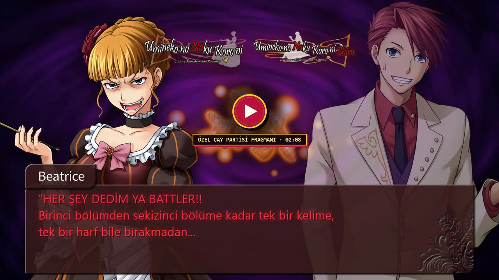
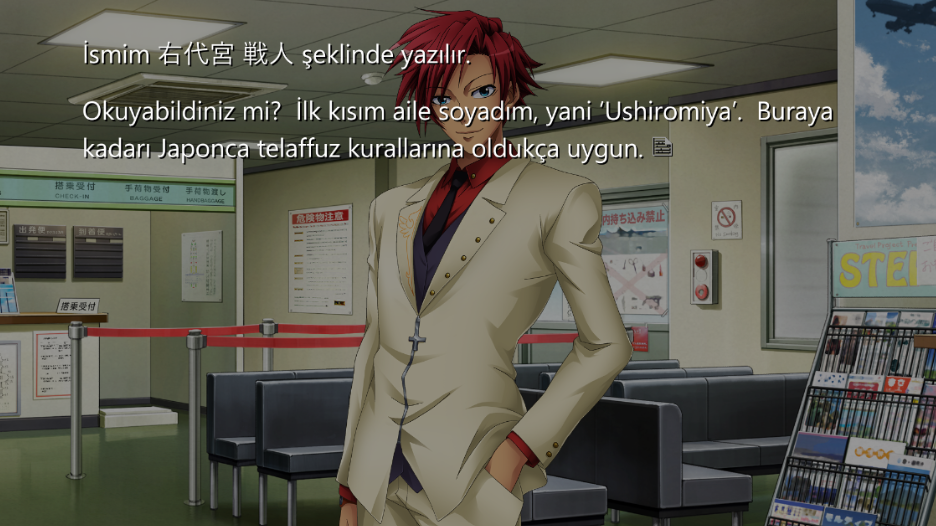
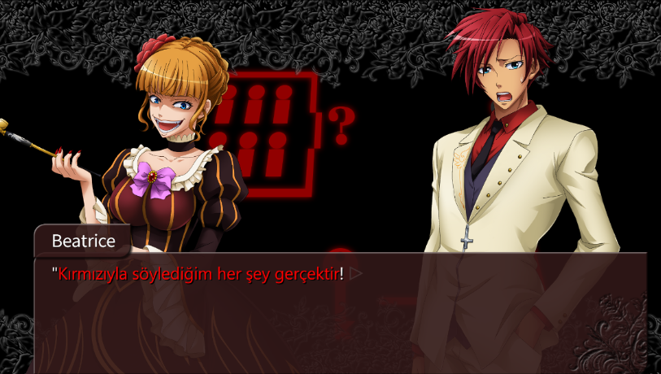

# Umineko When They Cry - Türkçe Yama (1-8. Bölümler)

Steam ve GOG üzerindeki **Umineko When They Cry - Question Arcs** (1-4. bölümler) ve **Umineko When They Cry - Answer Arcs / Chiru** (5-8. bölümler) sürümleri için hazırlanan tam kapsamlı Türkçe yerelleştirme yaması.

Yama `07th-Mod` (PS3 seslendirme ve 1080p grafik paketi) altyapısı üzerinde çalışır. Sekiz bölümün tamamındaki `130.412` diyalog satırı, renkli gerçek önermeleri, arayüz menüleri, oyun içi bulmacalar ve bölüm sonu parşömenleri eksiksiz olarak Türkçeye aktarılmıştır.

**Çeviri ve görsel uyarlama:** [@Remilya](https://github.com/Remilya) · [remilya.dev](https://remilya.dev)

> **Bilgilendirme:** Bu yamanın çevirisinde LLM (**Argon 4**, **Carbon 4** ve **Gemini**) kullanılmıştır. Bununla ilgili bir probleminiz varsa lütfen yamayı kullanmayınız.

## Tanıtım Fragmanı (Özel Çay Partisi)

Beatrice ve Battler'ın yama kapsamını, renkli gerçekleri ve görsel uyarlamaları spoiler vermeden anlattığı Özel Çay Partisi tanıtım videosunu izleyebilirsiniz:

  
  

    <a href="https://remilya.dev/Umineko/assets/umineko-tr-fragman.mp4"><strong>▶ Fragmanı Tam Kalite İzle (1080p60 Master)</strong></a>
    &nbsp;·&nbsp;
    <a href="https://remilya.dev/Umineko/"><strong>Web Sitesi ve Kurulum Rehberi (remilya.dev/Umineko)</strong></a>
    &nbsp;·&nbsp;
    <a href="https://drive.google.com/file/d/1SBi3Izux33Hkb7v79mEVL55Pib-TxllD/view?usp=sharing"><strong>Alternatif (Google Drive)</strong></a>
  

## Kurulum

Türkçe yama düz Steam veya GOG sürümüne doğrudan kurulmaz; önce oyunların üzerine PS3 çizimlerini, seslendirmeyi ve güncellenmiş oyun motorunu ekleyen resmi [07th-Mod Kurulum Aracı](https://wiki.07th-mod.com/Umineko/Umineko-Part-3a-Cross-Platform-Installer/) kurulmalıdır.

### 1. Adım: 07th-Mod Kurulum Ayarları

`07th-Mod.Installer.Windows.exe` aracını çalıştırdığınızda aşağıdaki seçenekleri kullanın. Uyumsuz bir varyant seçilmesi halinde Türkçe yama kurulum aracı klasörü kilitleyip uyarı verecektir:

| Ayar başlığı | Question Arcs (1-4. Bölümler) | Answer Arcs / Chiru (5-8. Bölümler) | Açıklama |
| :--- | :--- | :--- | :--- |
| **Choose Patch** | **`full Patch`** | **`adv-mode`** *(Önemli)* | `voice-only` seçmeyin. Chiru kurarken varsayılan `novel-mode` yerine mutlaka **`adv-mode`** işaretlenmelidir; aksi halde ADV metin kutusu dosyaları inmez. |
| **Translations** | `English/Japanese` | `English/Japanese` | Başka bir dil yamasını (*Ukrainian*, *Italian* vb.) seçmeyin. |
| **Experimental Script** | `No Change` | `No Change` | Deneysel senaryoyu açmayın; Türkçe yama kararlı ana senaryo tabanlıdır. |
| **Experimental Engine** | `No Change` | `No Change` | Varsayılan motor önerilir (deneysel motor kayıt dosyası uyumsuzluğu yaratabilir). |
| **Sprite / BGM Options** | `PS3 sprites` / `Default BGM` | `PS3 sprites` / `Default BGM` | İsteğe bağlıdır; *Pachinko*/*Ryukishi* çizimleri veya *Console BGM* seçilmesi yamayı bozmaz. |
| **Small Movie Fixes** | `No Change` | *Yok* | Windows'ta değiştirmeyin; yalnızca Linux / Steam Deck (Proton) kullanıcıları *Small Movie Fix* seçmelidir. |

> **Not:** Steam üzerinde *"Oyun dosyalarının bütünlüğünü doğrula"* yaparsanız veya oyunu silip yeniden yüklerseniz Steam oyun motorunu düz sürüme sıfırlar. Böyle bir durumda `07th-Mod` aracından **Quick Repair** seçeneğiyle modu onarıp Türkçe yamayı tekrar uygulamanız yeterlidir.

### 2. Adım: Türkçe Yama Kurulumu (`Umineko_TR_Kurulum.exe`)

Tek dosyalık kurulum sihirbazı **[Umineko_TR_Kurulum.exe](https://github.com/Remilya/Umineko/releases/latest/download/Umineko_TR_Kurulum.exe)** (`842 KB`) aracını doğrudan veya [GitHub Releases](https://github.com/Remilya/Umineko/releases/latest) sayfasından indirip çalıştırın.

Kurulum aracı bilgisayardaki Steam ve GOG dizinlerini otomatik tarar, `07th-Mod` motorunun aktif olduğunu doğrular ve seçtiğiniz oyunun paketini (`Umineko_Question_TR.zip` veya `Umineko_Answer_TR.zip`) GitHub üzerinden indirir. Mevcut dosyaları `_tr_backup/` altına yedekledikten sonra yamayı kurar; istediğiniz zaman araç içindeki **Yedeğe Dön** düğmesiyle tek tıkla İngilizce `07th-Mod` haline dönebilirsiniz.

ZIP paketlerini elle indirdiyseniz `Umineko_TR_Kurulum.exe` ile aynı klasöre koymanız yeterlidir; araç indirme aşamasını atlayıp yerel paketten kurar. Linux ve Steam Deck kullanıcıları ise ilgili ZIP arşivini doğrudan `07th-Mod` kurulmuş oyun kök dizinine açabilir.

## Ekran Görüntüleri

| Türkçe ve Japonca Kanji hibrit fontu (1. Bölüm) | Kırmızı Gerçek (`#ff0000`) ve ADV arayüzü (2. Bölüm) |
| :---: | :---: |
|  |  |

## Kapsam

### Soru Arkları (*Question Arcs*)

| Bölüm | Başlık | Dosya | Diyalog / İçerik | Renkli gerçekler | Durum |
| :---: | :--- | :---: | :---: | :---: | :---: |
| **1. Bölüm** | *Legend of the Golden Witch* | 20 / 20 | `14.692` segment | Yok | Tamamlandı |
| **2. Bölüm** | *Turn of the Golden Witch* | 21 / 21 | `14.736` segment | `59` Kırmızı | Tamamlandı |
| **3. Bölüm** | *Banquet of the Golden Witch* | 21 / 21 | `17.110` segment | `82` Kırmızı | Tamamlandı |
| **4. Bölüm** | *Alliance of the Golden Witch* | 22 / 22 | `20.749` segment | `112` Kırmızı, `121` Mavi | Tamamlandı |
| **Görseller + Font** | Menü, ipucu, karakter kartları, fontlar ve kapanışlar | `898` dosya | Arayüz, kartlar ve hibrit fontlar | Yok | Tamamlandı |
| **Toplam** | **Question Arcs (1-4. Bölümler)** | **84 bölüm** | **`67.287` segment** | **`253` Kırmızı, `121` Mavi** | **%100** |

### Cevap Arkları (*Answer Arcs / Chiru*)

| Bölüm | Başlık | Dosya | Diyalog / İçerik | Renkli gerçekler | Durum |
| :---: | :--- | :---: | :---: | :---: | :---: |
| **5. Bölüm** | *End of the Golden Witch* | 18 / 18 | `15.872` segment | `331` Kırmızı, `243` Mavi, `1` Altın | Tamamlandı |
| **6. Bölüm** | *Dawn of the Golden Witch* | 21 / 21 | `16.304` segment | `166` Kırmızı, `60` Mavi, `2` Altın | Tamamlandı |
| **7. Bölüm** | *Requiem of the Golden Witch* | 21 / 21 | `15.204` segment | `10` Kırmızı, `3` Mavi | Tamamlandı |
| **8. Bölüm** | *Twilight of the Golden Witch* | 20 / 20 | `15.745` segment | `34` Kırmızı, `12` Mavi, `98` Mor | Tamamlandı |
| **Görseller + Font** | Bulmacalar, gizem tahtası, arayüz, fontlar ve kapanışlar | `668` dosya | Arayüz, bulmacalar ve hibrit fontlar | Yok | Tamamlandı |
| **Toplam** | **Answer Arcs / Chiru (5-8. Bölümler)** | **80 bölüm** | **`63.125` segment** | **`541` Kırmızı, `318` Mavi, `3` Altın, `98` Mor** | **%100** |

## Çeviri ve Görsel Uyarlama Notları

### Renkli Gerçekler ve Terim Tutarlılığı

Umineko'daki dedektiflik kurgusu Kırmızı (`#ff0000`), Mavi (`#5decff`), Altın (`#ffcc00`) ve Mor (`#b400ff`) gerçek cümlelerindeki kelime seçimine dayanır. Tek bir olumsuzluk zarfının (*asla, hiçbir, yalnızca*) ya da anahtar/kapalı oda ifadesinin kayması ileriki bölümlerdeki mantık zincirini bozabileceği için tüm renkli gerçek önermeleri ve bölümler arası geri dönüş (*flashback*) replikleri birebir çapraz kontrol edilmiştir.

Seri boyunca özel anlam taşıyan temel terimler sabitlenmiştir:

| Japonca / İngilizce | Türkçe karşılığı |
| :--- | :--- |
| `家具` (*Furniture*) | `Eşya` |
| `無限の魔女` (*Endless Witch*) | `Sonsuzluk Cadısı` |
| `奇跡の魔女` (*Witch of Miracles*) | `Mucizeler Cadısı` |
| `黄金郷` (*Golden Land*) | `Altın Diyâr` |
| `杭` (*Stake / Wedge*) | `Kazık` / `Kama` |
| `密室` (*Closed room*) | `Kapalı oda` |
| `悪魔の証明` (*Devil's Proof*) | `Şeytanın Kanıtı` |

### Türkçe ve Japonca Kanji Hibrit Font Desteği

Oyun metninde karakter adlarının Kanji kökenleri (`右代宮 戦人`, `真里亞`, `朱志香`, `楼座`) sık sık Türkçe cümlelerin içinde yer alır. Ana diyalog fontları (`Segoe UI` + `Yu Gothic` / `Sazanami Gothic`) hem Türkçe karakterleri hem de `2.938` Japonca CJK glifini aynı satırda eksiksiz gösterir. Ayarlar ve Bölüm Atlama menülerinde kullanılan sabit genişlikli fontlara da Türkçe karakterler eklenerek tarih ve saat sütunlarının hizası korunmuştur.

### Görsel Arayüz, Bulmacalar ve Kapanış Parşömenleri

Her iki oyundaki karakter profil kartları, ipucu sayfaları, kaydet/yükle ekranları, sağ tık menüleri, Müzik Kutusu ve konuşmacı isim sekmeleri arka plan dokuları korunarak Türkçeye uyarlanmıştır. Başlık ve sinema logolarıyla birlikte `122` adet yarı saydam ADV metin kutusu filigranı (*"Cadı ve Muhakemenin Rondosu"* ve *"Hakikat ve İllüzyonların Noktürnü"*), 8. Bölümdeki `16` Cadılar Bayramı bilmecesi, mazeret şemaları, Bernkastel'in gizem tahtası ve tüm bölüm sonu parşömenleri Türkçe olarak yeniden dizilmiştir.
